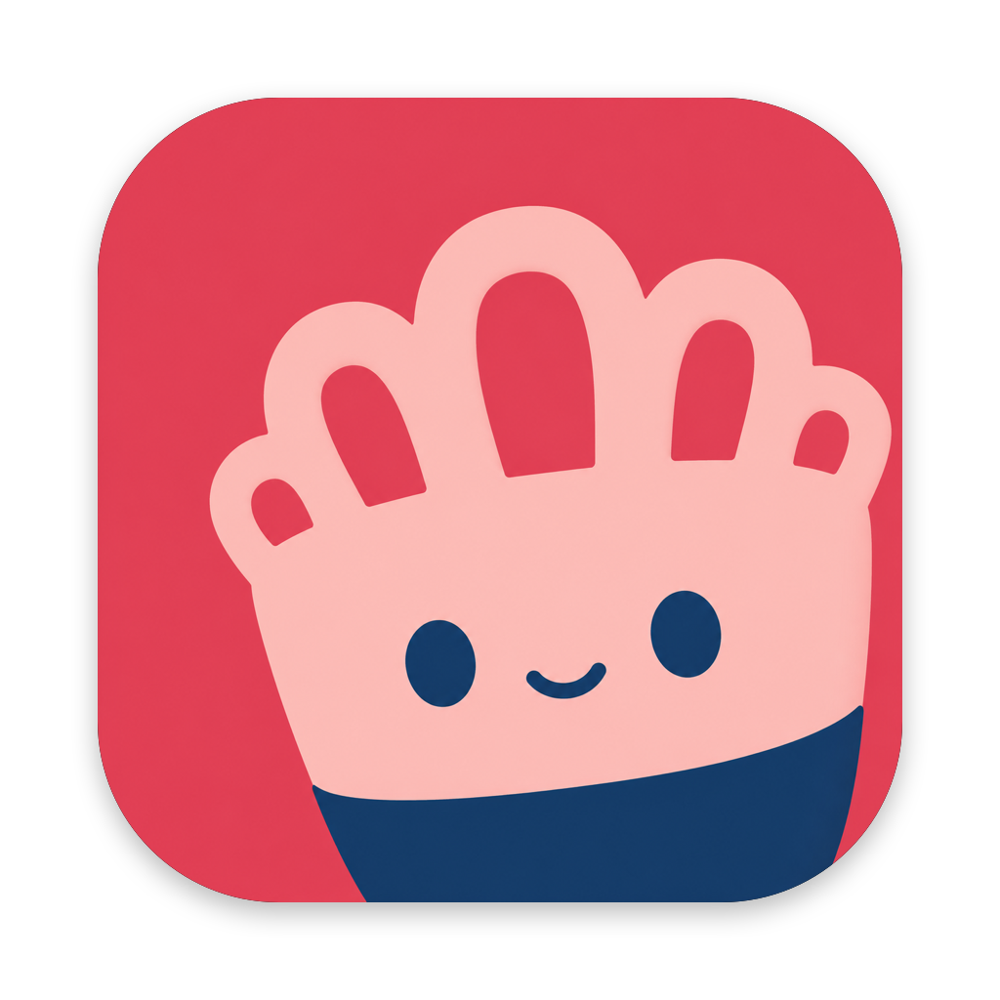
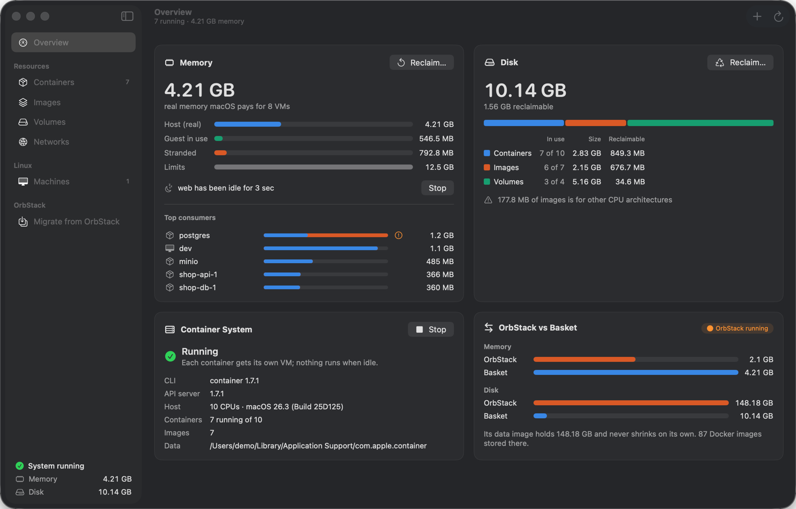
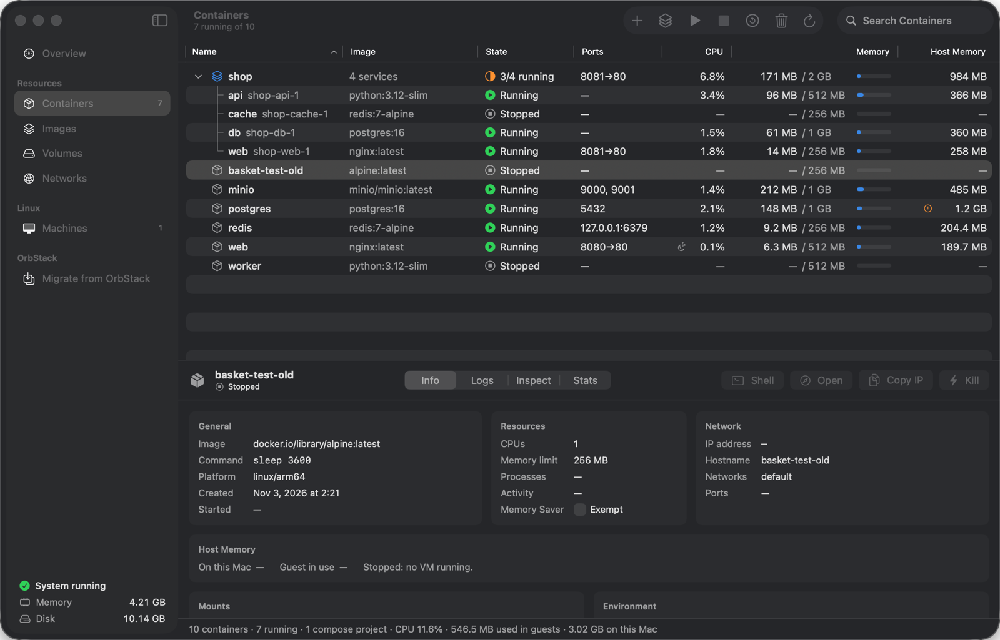
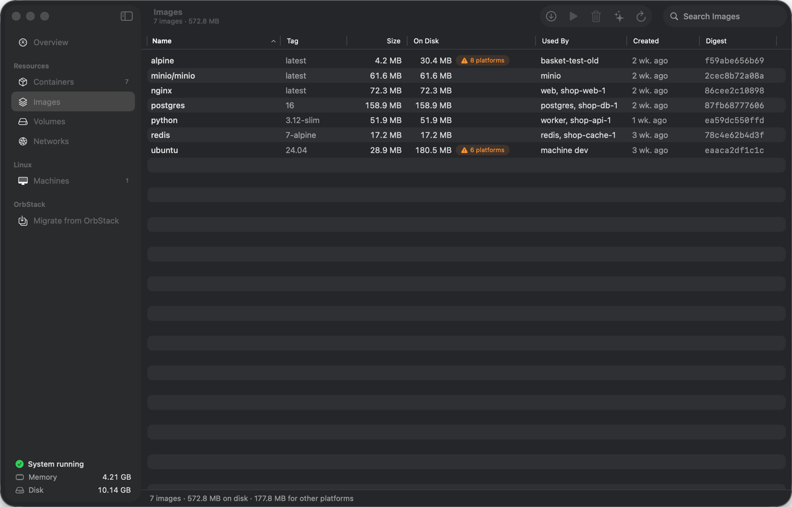
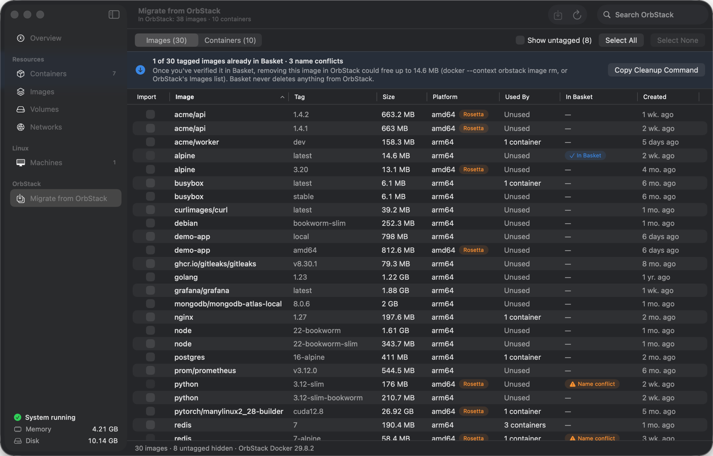
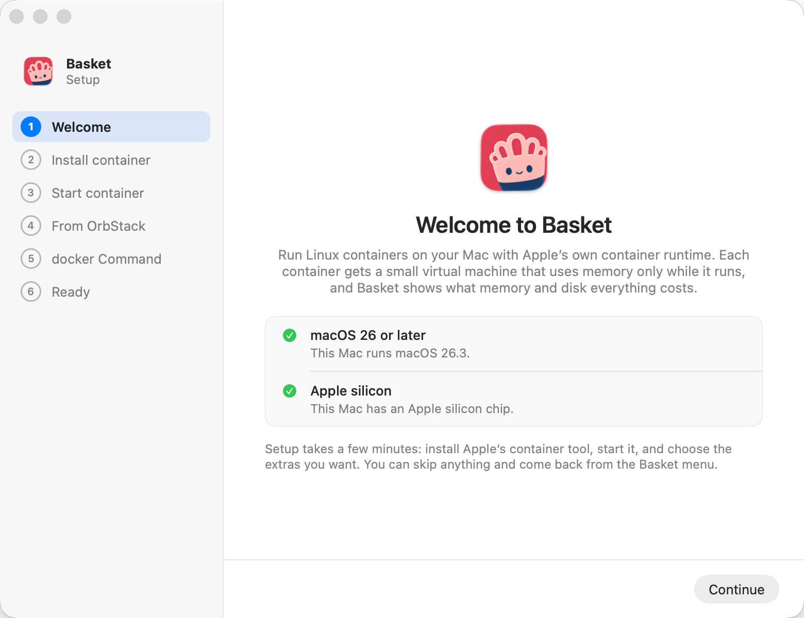

<p align="center"><b>English</b> · <a href="README.zh-CN.md">简体中文</a></p>

<p align="center">
  
</p>

<h1 align="center">Basket</h1>

<p align="center">
  A native macOS app that replaces OrbStack with Apple's
  <a href="https://github.com/apple/container"><code>container</code></a>, built around memory and disk use.
</p>

<p align="center">
  <a href="https://github.com/Kilerd/basket/actions/workflows/ci.yml"></a>
  <a href="LICENSE"></a>
  
  
</p>



<sub>All screenshots are generated from the synthetic `Fixtures/demo` data set by the
self-test. They show no real machine.</sub>

## Why

OrbStack and Docker Desktop run every container inside one Linux VM that is always on. That VM
holds on to memory, and its data image grows but does not shrink on its own. On the author's Mac,
OrbStack used 3.12 GB of memory and 148 GB of disk. Basket, with one container running, used
240 MB and 899 MB. That is a single snapshot, not a benchmark.

Apple's [`container`](https://github.com/apple/container) runs **each container in its own
lightweight VM** (Virtualization.framework). Memory is used only while a container runs and
is returned when it stops. Nothing runs when you have no containers. Images live in a
per-image content store, and volumes are sparse.

The per-container model has costs. Basket shows them rather than hiding them
([measurements](docs/EVOLUTION.md)):

- **Each running container VM costs about 230–310 MB of host memory**, whatever its memory
  limit: 256 MB limit → 240 MB, 1 GB → 287 MB, 2 GB → 312 MB. If you run many small containers
  at once, one shared VM can be cheaper.
- **Host memory follows the guest's high-water mark and does not shrink until the VM
  restarts.** There is no memory balloon and no free-page reporting. In one test, a guest
  touched 500 MB and then freed it. The host stayed at 778 MB while the guest used only 55 MB.
- So the useful memory levers are to stop idle containers and to restart containers that hold
  "stranded" memory. Lowering a memory limit only caps the high-water mark.

## Features

Available in `0.0.1`:

- **Memory first.** The Overview shows the real host memory each container VM uses (macOS
  footprint, not the guest's view), split into guest in use, VM overhead and **stranded**
  memory — what the VM still holds after the guest freed it. "Reclaim…" restarts only the
  containers you pick and returns that memory to macOS (one test: 809 MB → 287 MB).
  **Memory Saver** (off by default) stops containers idle for 15–120 minutes, never touching
  exempt, machine-backed or `--rm` containers.
- **Disk you can see and reclaim.** Disk use by category with the reclaimable amount; reclaim
  deletes exactly the items you approved. Images pull only this Mac's platform
  (`linux/arm64`) by default — a plain multi-platform pull of `alpine` stores about 10
  variants — and "Keep only linux/arm64" slims existing images locally without re-pulling.
- **Containers.** State, ports, CPU, guest and host memory in aligned columns; start, stop,
  restart, kill, delete; logs with follow, `inspect`, live stats, a shell in Terminal, open a
  published port, copy the IP; a run sheet with small memory defaults.
- **Docker Compose.** Compose projects are grouped in the container list (OrbStack style) with
  project-wide start/stop/restart/down and merged logs. *Compose Up…* reads a
  `compose.yaml` (Swift YAML parser, `${VAR}` interpolation, `.env`), shows a plan with the
  memory it will cost, and runs it. apple/container has no DNS between containers, so Basket
  writes service names into each container's `/etc/hosts`.
- **Migrate from OrbStack.** Imports OrbStack images (host platform only, content-verified)
  and recreates containers as `container run` commands, with warnings for what doesn't carry
  over. OrbStack is only read, through an allowlist of read-only `docker` commands.
- **`docker` command.** Optional `docker` shim that translates everyday `docker` commands to
  `container` ([what's supported](docs/docker-shim.md)); enabled only when you say so, with the
  exact shell lines shown first.
- **Guided setup.** First launch checks the Mac, installs `container` (Homebrew or the official
  installer), starts it, offers OrbStack migration and the `docker` command.
- **Volumes, networks, Linux machines** (`container machine`), a **menu bar extra** and
  **Settings** (CLI path, refresh interval, default memory, launch at login).
- **Signed updates.** Basket checks GitHub Releases daily (Settings ▸ Updates) and installs a
  new version only after verifying its signature and code signature ([how](docs/updates.md)).
- **Accessible by construction.** Every control has an accessible name and a stable
  identifier, and the UI is tested through the accessibility tree; see
  [How the UI is tested](#how-the-ui-is-tested).

**Six languages** (since 0.0.2) — English, 简体中文, 繁體中文, 日本語, Français and
Deutsch. Basket follows the macOS language, or the one chosen in Settings ▸ General ▸ Language.

Planned: `*.orb.local`-style DNS names, `container build`, Kubernetes and
optional Docker API compatibility. See the
[feature map](docs/EVOLUTION.md#orbstack--basket-feature-map) and the open issues.

| Containers and Compose projects | Images |
|---|---|
|  |  |

| Migrate from OrbStack | Guided setup |
|---|---|
|  |  |

## Requirements

- **macOS 26 or later on Apple silicon.** `container` needs both.
- **Apple's `container` CLI**, installed with Homebrew:

  ```sh
  brew install container
  ```

  Start the container system from Basket's Overview (or with `container system start`). Basket
  looks for the CLI in the usual Homebrew locations. You can also choose the path in Settings.

## Install

Download `Basket-X.Y.Z.dmg` from the [latest release](https://github.com/Kilerd/basket/releases/latest),
open it and drag Basket to Applications. Releases are signed with a Developer ID, notarized by
Apple, and carry build provenance attestations; `SHA256SUMS` lets you check the download
([how](docs/RELEASING.md#verifying-a-download)). Basket then keeps itself up to date: it checks
daily (Settings ▸ Updates) and installs only updates whose Ed25519 signature and notarized code
signature check out ([docs/updates.md](docs/updates.md)). Or build from source as described below.

## Build from source

You need Xcode 26 (Swift 6.2 or later) and the macOS 26 SDK. There are no third-party
dependencies.

```sh
git clone https://github.com/Kilerd/basket.git
cd basket
# Only if `xcode-select -p` points at the Command Line Tools:
export DEVELOPER_DIR=/Applications/Xcode.app/Contents/Developer

scripts/build-app.sh release      # → build/Basket.app
open build/Basket.app
```

`build-app.sh` signs the app with `$BASKET_SIGN_IDENTITY` if it is set. Otherwise it uses the
first "Developer ID Application" identity in your keychain, or an ad-hoc signature if there is
none. The app uses the hardened runtime. It is not sandboxed, because it runs the `container`
CLI.

Run the tests with `swift test`. Tests that use the real `container` CLI only run when you opt
in; see [CONTRIBUTING.md](CONTRIBUTING.md).

## How the UI is tested

Basket tests its UI the way VoiceOver sees it: through the macOS accessibility tree, against
deterministic fixture data. There is no pixel matching and no XCUITest.

1. **Self-test (needs no permissions).**

   ```sh
   scripts/selftest.sh demo     # also: empty, stopped
   BASKET_LANGUAGE=de scripts/selftest.sh demo   # in another language
   ```

   The app starts with the fixture backend (`Fixtures/<set>`, raw `container … --format json`
   output with synthetic content). It visits every section, walks its own accessibility tree
   in-process, and writes `<section>.ax.json` and `<section>.png`. Then
   `basket-ax lint` audits the dumps. CI runs this on every pull request.
2. **End-to-end test (needs Accessibility permission once).**

   ```sh
   scripts/e2e.sh demo
   ```

   A separate runner app, `BasketE2E.app`, launches Basket and drives it from outside the
   process with `AXUIElement`: it presses sidebar items and buttons, captures the tree as an
   assistive app would, and runs the same rules.

The rules check that:

- every interactive element has an accessible name;
- nothing lies outside its window;
- sibling controls don't overlap, and hit targets aren't tiny;
- buttons in a group share a height;
- identifiers are unique, and text isn't obviously truncated;
- every section follows a shared **identifier contract**: `sidebar.<section>`,
  `<section>.search`, `<section>.action.refresh`, `<section>.list` or `<section>.empty`, and so
  on.

Reports and screenshots go to `artifacts/` (ignored by git). The details are in
[docs/ARCHITECTURE.md](docs/ARCHITECTURE.md#accessibility-ax-testing).

## Project status

Basket is **early (0.0.x): expect breaking changes**. Each iteration that lands on `main` is
released as the next patch version (`0.0.1`, `0.0.2`, …). The roadmap, measurements and
iteration log are in [docs/EVOLUTION.md](docs/EVOLUTION.md). The changes themselves are in
[CHANGELOG.md](CHANGELOG.md).

## Contributing

Contributions are welcome. Start with [CONTRIBUTING.md](CONTRIBUTING.md). It covers setup, the
checks your change must pass, and the issue-first workflow. The rules for working on this public
repository are in [AGENTS.md](AGENTS.md), which applies to humans and coding agents alike. Never
put credentials or data from your own machine into issues, PRs or fixtures.

- Report security problems privately: see [SECURITY.md](SECURITY.md).
- This project follows the [Contributor Covenant](CODE_OF_CONDUCT.md).

## License

Basket is licensed under the [Apache License 2.0](LICENSE). See [NOTICE](NOTICE) for
attributions. Contributions are accepted under the same license.

## Credits

- **Logo:** the "basket-star" mascot from the [IP as Logo](https://visualskills.dev/ip-as-logo)
  collection ([s1dashu/ip-as-logo-skill](https://github.com/s1dashu/ip-as-logo-skill)). It is
  offered free to download and use commercially. The source and the derived app icon are
  described in [Resources/Branding/README.md](Resources/Branding/README.md).
- **[apple/container](https://github.com/apple/container)** (Apache-2.0) and
  Virtualization.framework do the actual work. Basket is a front end that drives the `container`
  CLI and contains no code from it.
- Basket is an independent project. It is not affiliated with or endorsed by Apple or OrbStack.
