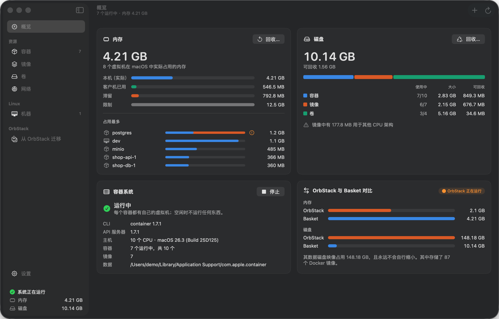
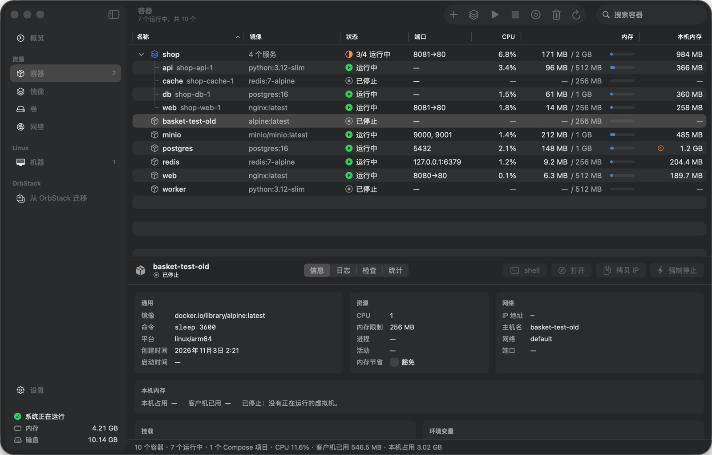
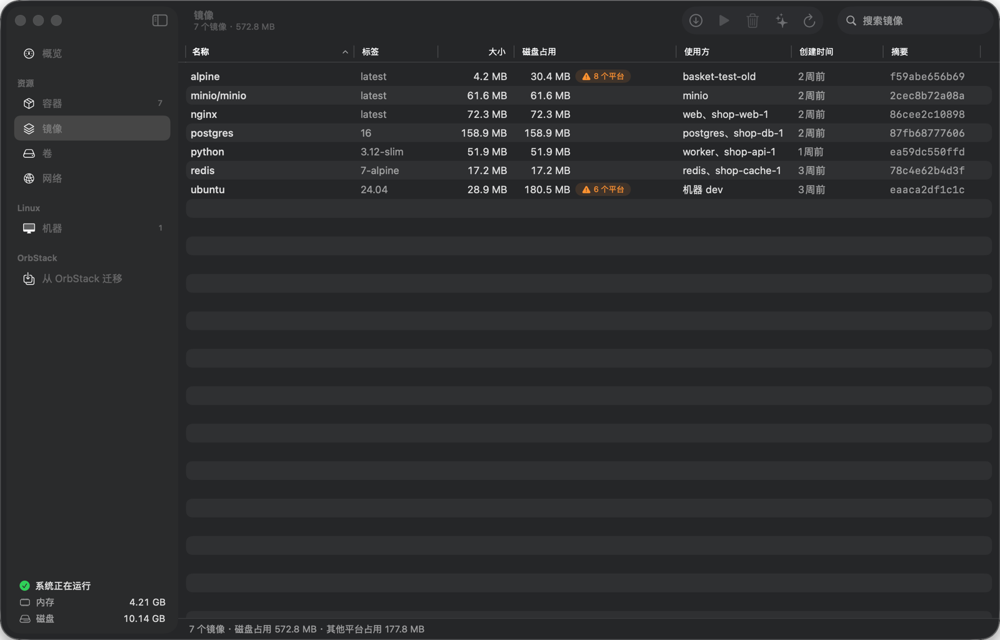
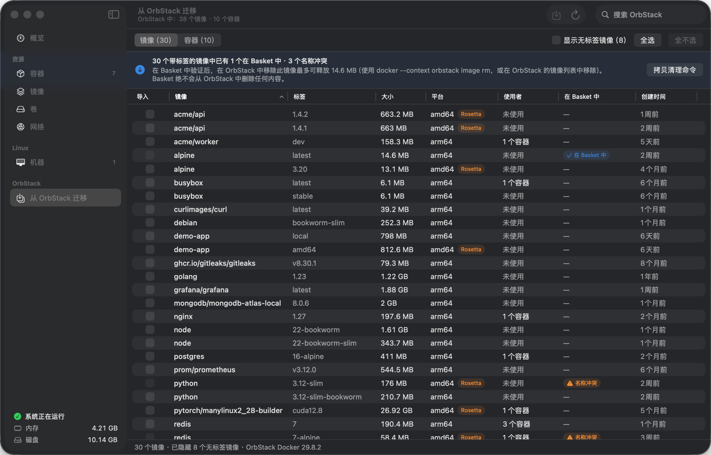
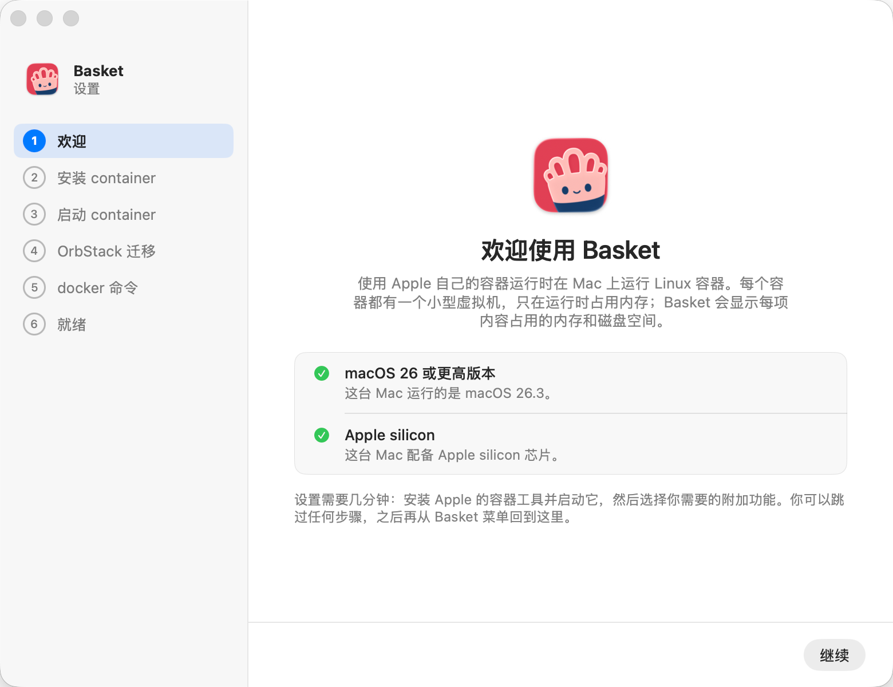

<p align="center"><a href="README.md">English</a> · <b>简体中文</b></p>

<p align="center">
  
</p>

<h1 align="center">Basket</h1>

<p align="center">
  一款原生 macOS 应用，用 Apple 的
  <a href="https://github.com/apple/container"><code>container</code></a> 取代 OrbStack，围绕内存和磁盘占用而设计。
</p>

<p align="center">
  <a href="https://github.com/Kilerd/basket/actions/workflows/ci.yml"></a>
  <a href="LICENSE"></a>
  
  
</p>



<sub>所有截图都由自检程序基于合成的 `Fixtures/demo` 数据集生成，不包含任何真实机器的数据。</sub>

> 本文是 [README.md](README.md) 的中文译本；两者不一致时以英文版为准。代码、提交信息、PR 和文档使用英文，issue 和讨论可以用中文。

## 为什么

OrbStack 和 Docker Desktop 把所有容器都放在一个常驻的 Linux 虚拟机里运行。这个虚拟机会一直占着内存，它的数据镜像文件只会变大，不会自己缩小。在作者的 Mac 上，OrbStack 占用了 3.12 GB 内存和 148 GB 磁盘；运行一个容器的 Basket 只占用 240 MB 和 899 MB。这只是一次快照，不是基准测试。

Apple 的 [`container`](https://github.com/apple/container) 让**每个容器运行在各自的轻量虚拟机里**（Virtualization.framework）。只有容器运行时才占用内存，容器停止后内存就还给 macOS。没有容器时什么都不运行。镜像存放在按镜像划分的内容存储中，卷是稀疏文件。

每容器一个虚拟机的模式也有代价。Basket 把这些代价展示出来，而不是藏起来（[测量数据](docs/EVOLUTION.md)）：

- **每个运行中的容器虚拟机大约占用 230–310 MB 本机内存**，与内存上限无关：上限 256 MB → 240 MB，1 GB → 287 MB，2 GB → 312 MB。如果同时运行很多小容器，一个共享的虚拟机可能更省。
- **本机内存跟随客户机的内存使用峰值，直到虚拟机重新启动前都不会缩小**。没有内存气球（balloon），也没有空闲页上报。在一次测试中，客户机先用了 500 MB 又释放掉，本机仍占 778 MB，而客户机只用了 55 MB。
- 因此真正有用的内存手段是：停止空闲的容器，以及重新启动持有“滞留”内存的容器。调低内存上限只能限制峰值。

## 功能

`0.0.1` 已提供：

- **内存优先**。概览显示每个容器虚拟机真实占用的本机内存（macOS 的内存占用，而不是客户机看到的数字），并拆分为客户机已用、虚拟机开销和**滞留**内存——即客户机已经释放、但虚拟机仍然占着的内存。“回收…”只重新启动你选中的容器，把这部分内存还给 macOS（一次测试：809 MB → 287 MB）**。内存节省**（默认关闭）会停止空闲 15–120 分钟的容器，但不会动被排除的、由机器使用的或以 `--rm` 启动的容器。
- **看得见、能回收的磁盘空间**。按类别显示磁盘占用和可回收的量；回收时只删除你确认过的项目。默认只拉取这台 Mac 所用平台（`linux/arm64`）的镜像——普通的多平台拉取一个 `alpine` 会存下约 10 个变体——“只保留 linux/arm64”可以在本地精简已有镜像，无需重新拉取。
- **容器**。状态、端口、CPU、客户机内存和本机内存按列对齐；启动、停止、重新启动、强制停止、删除；可跟随的日志、`inspect`、实时统计、在终端中打开 shell、打开已发布的端口、拷贝 IP；新建容器时默认使用较小的内存。
- **Docker Compose**。Compose 项目在容器列表中分组显示（与 OrbStack 相同），可对整个项目启动、停止、重新启动、关闭（down），并合并查看日志。*Compose Up…* 读取 `compose.yaml`（Swift 编写的 YAML 解析器，支持 `${VAR}` 插值和 `.env`），先展示包含内存开销的计划，再运行。apple/container 的容器之间没有 DNS，所以 Basket 会把服务名写入每个容器的 `/etc/hosts`。
- **从 OrbStack 迁移**。导入 OrbStack 的镜像（仅本机平台，按内容校验），并把容器重新创建为 `container run` 命令，对无法迁移的设置给出警告。Basket 只读取 OrbStack，且只通过一份只读 `docker` 命令白名单。
- **`docker` 命令**。可选的 `docker` 垫片会把日常的 `docker` 命令转换为 `container` 命令（[支持范围](docs/docker-shim.md)）；只有你同意后才会启用，并且会先给出要写入的确切 shell 配置行。
- **引导式设置**。首次启动时检查这台 Mac，安装 `container`（通过 Homebrew 或官方安装器）并启动它，然后提供 OrbStack 迁移和 `docker` 命令。
- **卷、网络、Linux 机器**（`container machine`）、**菜单栏附加项**，以及边栏底部的**设置**（语言、CLI 路径、刷新间隔、默认内存、登录时打开）。
- **签名更新**。Basket 每天检查 GitHub Releases（设置 ▸ 更新），只有在验证签名和代码签名之后才安装新版本（[说明](docs/updates.md)）。
- **从设计上就支持辅助功能**。每个控件都有可读的辅助功能名称和稳定的标识符，界面通过辅助功能树进行测试；参见[界面如何测试](#界面如何测试)。

**六种语言**（自 0.0.2 起）——English、简体中文、繁體中文、日本語、Français 和 Deutsch。Basket 跟随 macOS 的语言，也可以在“设置 ▸ 通用 ▸ 语言”中另选（“设置”位于边栏底部，或按 ⌘,；Basket 重新打开后即切换）。

计划中：类似 `*.orb.local` 的 DNS 名称、`container build`、Kubernetes，以及可选的 Docker API 兼容。参见[功能对照表](docs/EVOLUTION.md#orbstack--basket-feature-map)和尚未关闭的 issue。

| 容器和 Compose 项目 | 镜像 |
|---|---|
|  |  |

| 从 OrbStack 迁移 | 引导式设置 |
|---|---|
|  |  |

## 系统要求

- **搭载 Apple 芯片、运行 macOS 26 或更高版本的 Mac**。`container` 两者都需要。
- **Apple 的 `container` CLI**，用 Homebrew 安装：

  ```sh
  brew install container
  ```

  在 Basket 的概览中启动容器系统（或运行 `container system start`）。Basket 会在 Homebrew 的常用位置查找 CLI，你也可以在设置中指定路径。

## 安装

从[最新版本](https://github.com/Kilerd/basket/releases/latest)下载 `Basket-X.Y.Z.dmg`，打开后把 Basket 拖到“应用程序”文件夹。发布版本使用 Developer ID 签名、经过 Apple 公证，并附带构建来源证明（build provenance attestation）；可以用 `SHA256SUMS` 校验下载的文件（[方法](docs/RELEASING.md#verifying-a-download)）。之后 Basket 会自动保持最新：它每天检查一次（设置 ▸ 更新），只安装 Ed25519 签名和经过公证的代码签名都校验通过的更新（[docs/updates.md](docs/updates.md)）。也可以按下文从源代码构建。

> **请安装 0.0.4 或更高版本。** 不推荐 0.0.1–0.0.3：它们的更新程序可能停在“正在安装…”（出现后 2 分钟内强制退出 Basket 即可完成更新，或直接安装最新的 DMG）。

## 从源代码构建

需要 Xcode 26（Swift 6.2 或更高版本）和 macOS 26 SDK。没有任何第三方依赖。

```sh
git clone https://github.com/Kilerd/basket.git
cd basket
# 仅当 `xcode-select -p` 指向 Command Line Tools 时需要：
export DEVELOPER_DIR=/Applications/Xcode.app/Contents/Developer

scripts/build-app.sh release      # → build/Basket.app
open build/Basket.app
```

如果设置了 `$BASKET_SIGN_IDENTITY`，`build-app.sh` 会用它为应用签名；否则使用钥匙串中的第一个“Developer ID Application”身份，如果没有，则使用临时（ad-hoc）签名。应用启用了强化运行时（hardened runtime）。它没有启用沙盒，因为它要运行 `container` CLI。

用 `swift test` 运行测试。使用真实 `container` CLI 的测试只有在你主动开启时才会运行；参见 [CONTRIBUTING.md](CONTRIBUTING.md)。

## 界面如何测试

Basket 按照旁白（VoiceOver）看到的方式测试界面：通过 macOS 辅助功能树，基于确定的夹具（fixture）数据。不做像素比对，也不用 XCUITest。

1. **自检（不需要任何权限）**。

   ```sh
   scripts/selftest.sh demo     # 还有：empty、stopped
   BASKET_LANGUAGE=zh-Hans scripts/selftest.sh demo   # 用其他语言运行
   ```

   应用以夹具后端启动（`Fixtures/<set>`，即内容为合成数据的原始 `container … --format json` 输出）。它依次访问每个部分，在进程内遍历自己的辅助功能树，写出 `<section>.ax.json` 和 `<section>.png`，然后由 `basket-ax lint` 审查这些转储。CI 在每个拉取请求上都会运行它。
2. **端到端测试（需要授予一次辅助功能权限）**。

   ```sh
   scripts/e2e.sh demo
   ```

   一个独立的运行器应用 `BasketE2E.app` 启动 Basket，并通过 `AXUIElement` 从进程外操作它：点按边栏项目和按钮，像辅助应用那样捕获辅助功能树，再运行同样的规则。

这些规则检查：

- 每个可交互元素都有辅助功能名称；
- 没有元素超出所在的窗口；
- 相邻控件互不重叠，点按区域不会过小；
- 同一组按钮高度一致；
- 标识符唯一，文本没有明显被截断；
- 每个部分都遵守共同的**标识符约定**：`sidebar.<section>`、`<section>.search`、`<section>.action.refresh`、`<section>.list` 或 `<section>.empty` 等。

报告和截图写入 `artifacts/`（不纳入 git）。详情见 [docs/ARCHITECTURE.md](docs/ARCHITECTURE.md#accessibility-ax-testing)。

## 项目状态

Basket 处于**早期阶段（0.0.x）：随时可能有不兼容的变更**。每一次合入 `main` 的迭代都会作为下一个补丁版本发布（`0.0.1`、`0.0.2`……）。路线图、测量数据和迭代日志在 [docs/EVOLUTION.md](docs/EVOLUTION.md)，具体变更见 [CHANGELOG.md](CHANGELOG.md)。

## 参与贡献

欢迎贡献。请从 [CONTRIBUTING.md](CONTRIBUTING.md) 开始，其中介绍了环境配置、改动必须通过的检查，以及“先开 issue”的工作流程（也包括如何翻译界面文字和添加新语言）。在这个公开仓库中工作的规则见 [AGENTS.md](AGENTS.md)，它同样适用于人和编程智能体。切勿在 issue、PR 或夹具中放入凭据或你自己机器上的数据。

- 安全问题请私下报告：见 [SECURITY.md](SECURITY.md)。
- 本项目遵守[贡献者公约](CODE_OF_CONDUCT.md)。

## 许可证

Basket 采用 [Apache License 2.0](LICENSE) 许可。署名信息见 [NOTICE](NOTICE)。贡献按相同的许可证接受。

## 致谢

- **标志**：来自 [IP as Logo](https://visualskills.dev/ip-as-logo) 合集（[s1dashu/ip-as-logo-skill](https://github.com/s1dashu/ip-as-logo-skill)）的“basket-star”吉祥物，可免费下载并用于商业用途。来源及由此制作的应用图标说明见 [Resources/Branding/README.md](Resources/Branding/README.md)。
- 真正干活的是 **[apple/container](https://github.com/apple/container)**（Apache-2.0）和 Virtualization.framework。Basket 是驱动 `container` CLI 的前端，不包含它的任何代码。
- Basket 是独立项目，与 Apple 或 OrbStack 没有关联，也未获得其认可。
